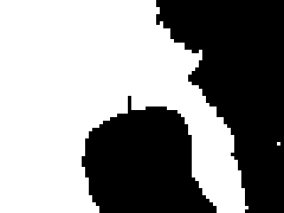
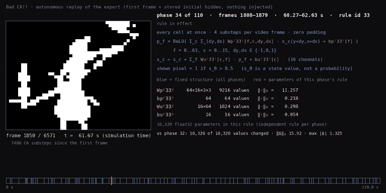
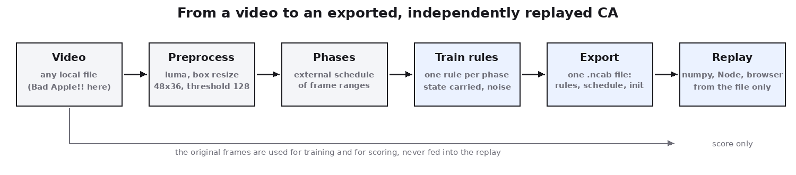
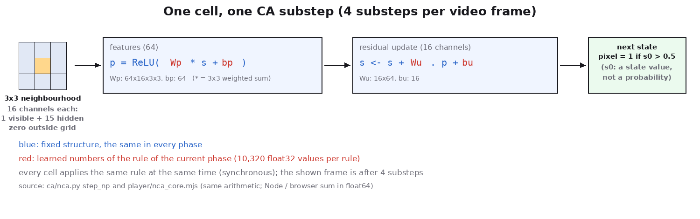
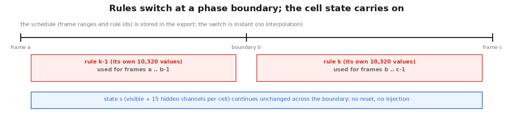
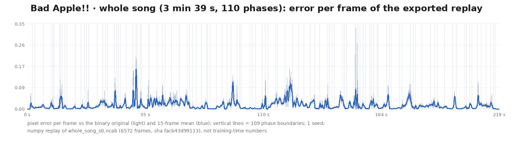
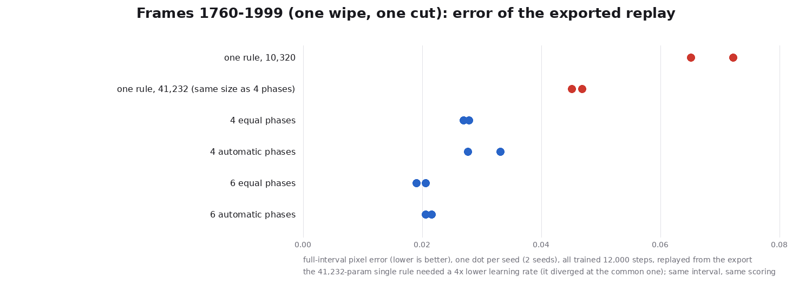
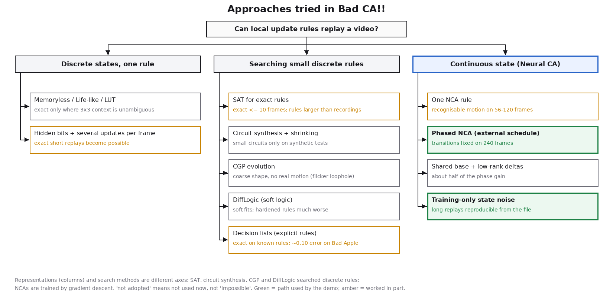

<p align="center">
  
</p>

<h1 align="center">Bad CA!!</h1>

<p align="center">
  Replays a video with phase-wise local update rules, and lets you inspect those rules and every cell's state.
</p>

<p align="center">
  <a href="#quick-start">Quick start</a> ·
  <a href="#demo">Demo</a> ·
  <a href="#how-it-works">How it works</a> ·
  <a href="#results-and-limits">Results and limits</a> ·
  <a href="#why-this-approach">Why this approach</a> ·
  <a href="docs/research/journey.md">How we got here</a>
</p>

> **Status (2026-11-11).** Bad CA!! replays the **whole Bad Apple!! video** (frames 0–6571, 3 min 39 s) from one
> exported file: a phased Neural CA with 110 phases, one learned local rule per phase, an external schedule, and the
> cell state carried across every phase change. The same file replays in numpy, Node and the browser. It passes the
> project's fixed acceptance criteria (`docs/CAMPAIGN_13.md` §3), with the weak spots listed under
> [Results and limits](#results-and-limits). This is **one trained model (seed 0)**; a second seed is still being
> trained. The rules are learned float32 networks, not small Boolean rules, and the file is larger than a lossless
> recording.

## Demo

<p align="center">
  <a href="assets/demo/whole_song.mp4"></a>
</p>

<p align="center"><a href="assets/demo/whole_song.mp4">▶ whole song (MP4, 3 min 39 s, 9.1 MB)</a>, rendered from the exported file. GitHub opens it in the file view; there is no external hosting. The preview above is 6 s (frames 1850–2029) cut from it.</p>

**What you just watched.** Every frame on the left is computed from one exported file, nothing else:

1. **Initial state:** the first frame (black) is stored as the visible layer, plus a small learned low-resolution
   array (1,620 values) as the hidden layers (15 channels per cell), which the rules grow the opening from.
2. **Local update:** each cell reads its 3×3 neighbourhood (all 16 channels) and applies the update shown on the right.
   All cells update at once, 4 times per video frame. A pixel is shown when the visible channel exceeds 0.5.
3. **One rule per phase:** all cells share the same rule within a phase (blue = fixed structure, red = that phase's learned
   numbers, 10,320 per rule).
4. **Rule changes follow a timeline:** the timeline (bottom) switches rules at fixed frames, and the switch is instant.
   This is a time-varying CA with an *external* schedule.
5. **State carries on:** visible and hidden state continue across a switch. There is no reset and no target frame is
   injected after the first one.
6. **Original for comparison only:** the original video is used only for training and for comparison, never as input
   to the replay.

## Quick start

Requires Python 3.12 with `requirements.txt` (numpy, scipy, PyAV, Pillow, JAX) and Node 24 for the independent player.
Bad Apple!! itself is not included (see [Data and licence](#data-and-licence)).

```sh
git clone https://github.com/VectorSophie/Bad-CA.git && cd Bad-CA
python3.12 -m venv .venv && .venv/bin/pip install -r requirements.txt

# local UI on 127.0.0.1 (Ctrl-C to stop): the demo model plays from its file, even without the source video
.venv/bin/python ui/server.py --port 8766        # open http://127.0.0.1:8766/

# replay any export from the file alone (Node), and inspect it
node player/nca_replay.mjs runs/featured/whole_song_s0.ncab          # whole song, ~1 min
.venv/bin/python -m ca.pipeline info runs/featured/whole_song_s0.ncab

# your own clip: CPU demo preset (small, minutes); phased training with --phases uniform:K
.venv/bin/python -m ca.pipeline run my.mp4 runs/pipe/mine --start 0 --frames 24 --width 32 --preset demo
```

Comparison with the original in the UI needs the source video at `refs/Bad-Apple-Starter/BadApple!!.mp4`, followed by
`ui/make_examples.sh`; without it the CA plays alone. GPU training uses JAX with a CUDA build of jaxlib.

## How it works







- **Preprocessing:** the video is reduced to a 48×36 binary grid (luma, box resize, threshold 128). The loss from that
  reduction is separate from the CA's own error.
- **Training:** consecutive phases are trained together in chunks of about 8 s, with the state carried from chunk to chunk.
  Small Gaussian noise is added to the state during training only, so the rules tolerate tiny numerical differences.
- **Export:** `.ncab` v2 holds the first frame, the initial hidden array, every phase's rule and the schedule.
- **Replay:** independent players (numpy, Node, browser) read only that file. They agree to float precision; a few
  threshold pixels can differ.

Details: [architecture](docs/architecture.md), [rule models](docs/rule-models.md), [file formats](docs/format.md),
[evaluation](docs/evaluation.md).

## Results and limits





**Whole song (the featured model, seed 0, replayed from its file):**
- **Error:** 0.0152 wrong pixels per frame on average. Every 240-frame window stays ≤ 0.041; all 191 blank (fade)
  frames are reproduced.
- **Motion:** the replay matches the original's motion in every window where the original moves.
- **Thin structure:** thin parts and gaps are kept at 0.83 / 0.78 recall. A blurred copy of the original reaches only
  0.71 / 0.63, and that is one of the checks it fails.
- **Implementations agree:** numpy, Node and the browser replay the same file. Node and the browser are bit-identical;
  numpy differs in 92 threshold pixels over the whole song, with no growth over time.
- **Transitions** (earlier comparison, figure above): on a 240-frame stretch with a wipe and a cut, a single rule
  reaches 0.065–0.072. A single rule as large as four phases reaches 0.045–0.047, while 4–6 phases reach 0.019–0.033.
  Same steps, 2 seeds each.

**Limits:**
- **Fast wipes and cuts are the weakest parts.** Three short stretches exceed 0.09 error over 16 frames: frames
  1499–1530, 2849–2874 and 3641–3682 (1.5 % of the song). Single frames at cuts reach ~0.3.
- **Speckle:** the replay has about 2× the small specks and 2.7× the small holes of the original, and some
  single-frame flicker (0.39 spurious flips per frame).
- **One seed.** A second, independent training run is in progress; until it finishes, reproducibility of the
  *procedure* is not shown, only of this *file*.
- **Automatic segmentation** of phases was never better than equal spacing.
- **Not compression:** the whole-song model is 4.2 MB; the same frames stored losslessly (1 bit/px + zlib) take 231 kB.
- **Readable rules:** explicit condition rules run exactly (UI "Rule lab"), but on Bad Apple they reach only about 0.10
  error on a 2-second clip.
- **Other videos:** they run through the same pipeline, but quality has only been studied on Bad Apple.

## Why this approach



1. **Simple local rules first.** Memoryless, Life-like and lookup-table rules replay frames exactly only where the 3×3
   context never conflicts. The video quickly produces conflicts.
2. **Memory and several updates per frame.** These made exact short replays possible (SAT search, up to ~10 frames). But
   the rules grew larger than the recordings, and the search timed out on longer clips.
3. **Searching for small rules directly.** Circuit synthesis, CGP, DiffLogic and decision lists gave small rules that
   follow coarse shapes but not real motion; some scores were flicker loopholes.
4. **Continuous state.** A Neural CA with hidden channels produced recognisable motion from the first frame, and a
   contour-weighted loss cleaned the outlines. This gave up "small rule" for "replays the video".
5. **Change the rule with the scene.** One rule failed across wipes and cuts. Per-phase rules with carried state fixed
   that, at 4–6 times the parameters. Automatic phase boundaries did not beat equal spacing.
6. **Keep long replays stable.** Chained rules amplified float-order differences until a whole-song replay fell
   apart after ~1,080 frames. Training with small state noise, and carrying chunk states with the replay's own
   arithmetic, made the exported replay match training. The whole song then passed.

The full story with evidence and costs: [How we got here](docs/research/journey.md); the original campaign records:
[research index](docs/research/README.md).

## Data and licence

- **Bad Apple!! video and music are not part of this repository.** The experiments use a local copy (sha256
  `d8f21232…cd0`, 480×360, 6,572 frames at 30 fps) from a clone of `C-mykk/Bad-Apple-Starter`; its upstream identity
  is not verified.
- **Derived material:** committed results and videos contain 48×36 binary frames derived from it for research
  comparison. The logo is a pixelated frame of the video (`assets/logo/README.md`); its rights stay with their owners.
- **Licence:** GNU GPL v3.0 (`LICENSE`), for this project's code and documentation. The bundled fonts keep their SIL
  OFL licences (`ui/static/fonts/`).
- **Former name:** the project was called CA-universal until 2026-11; the campaign records keep that name, and the
  Python package (`ca`) and format identifiers (`ca-universal/...`) are unchanged.

README layout follows the structure of [VectorSophie/hgit](https://github.com/VectorSophie/hgit).
