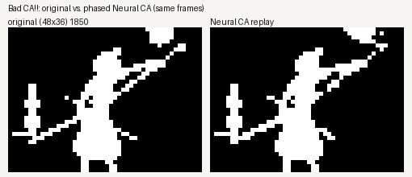

<p align="center">
  
</p>

<h1 align="center">Bad CA!!</h1>

<p align="center">
  A cellular automaton that plays the whole of Bad Apple!!, frame by frame, from local rules.
</p>

<p align="center">
  <a href="#see-it-running">See it running</a> ·
  <a href="#how-it-works">How it works</a> ·
  <a href="#try-it">Try it</a> ·
  <a href="#other-experiments">Other experiments</a> ·
  <a href="#limitations">Limitations</a> ·
  <a href="docs/research/journey.md">How we got here</a>
</p>

## What is this?

A cellular automaton is a grid of cells that all update at the same time, each one looking only at its neighbours.
Conway's Game of Life is the famous example. I wanted to know whether one could play a whole animated video, and
Bad Apple!! (black and white, 6,572 frames) was the obvious test.

The small, Life-style rules I tried first could follow a shape for a few frames and then fell apart. What finally
worked is a *trained* cellular automaton. Every cell carries some hidden numbers next to its visible pixel, and the
update rule is a tiny neural network that each cell applies to its 3×3 neighbourhood. Started from the first frame,
it plays the entire song.

## See it running

<p align="center">
  
</p>

Left: the original, shrunk to a 48×36 black-and-white grid. Right: the cellular automaton, replayed from the saved
model file. No video frames are fed in after the first one.

<p align="center">
  <a href="assets/demo/whole_song.mp4"></a>
</p>

<p align="center"><a href="assets/demo/whole_song.mp4">▶ whole song (MP4, 3 min 39 s, 9.1 MB)</a>, rendered from the saved model. The clip above
(frames 1850–2029) also shows the rule in effect and the rule timeline.</p>

## How it works


1. **Shrink the video.** Each frame becomes a 48×36 grid of black and white cells.
2. **Give every cell a state.** A cell holds 16 numbers: one is the pixel you see (shown white when it is above 0.5)
   and 15 are hidden memory.
3. **Update locally.** Every cell reads the 16 numbers of itself and its 8 neighbours, runs them through the same
   small network (10,320 learned numbers) and adds the result to its state. All cells do this at once, four times per
   video frame.
4. **Train.** The rule's numbers are learned by running the automaton and comparing what it draws with the real
   frames. The video is only used here, and for side-by-side comparisons.
5. **Replay.** The saved file holds the first frame, a small learned starting pattern for the hidden memory (1,620
   numbers) and the rules. The players read that file and nothing else.


One honest detail: the full song does not use a single rule. It is split into 110 sections, each with its own learned
rule, and a fixed timeline switches between them. The hidden memory carries over at every switch, so the animation
never restarts. In other words, it is a cellular automaton whose rule changes on a schedule.


Details: [architecture](docs/architecture.md), [rule models](docs/rule-models.md), [file formats](docs/format.md),
[evaluation](docs/evaluation.md).

## Try it

You need Python 3.12 and Node 24. Bad Apple!! itself is not included (see [Data and licence](#data-and-licence)),
and you don't need it to watch the trained model.

```sh
git clone https://github.com/VectorSophie/Bad-CA.git && cd Bad-CA
python3.12 -m venv .venv && .venv/bin/pip install -r requirements.txt

# viewer on http://127.0.0.1:8766/ (Ctrl-C to stop): plays the saved model, cell by cell if you like
.venv/bin/python ui/server.py --port 8766

# replay the whole song from the model file alone, without the viewer (a few minutes on a CPU)
node player/nca_replay.mjs runs/featured/whole_song_s0.ncab
.venv/bin/python -m ca.pipeline info runs/featured/whole_song_s0.ncab    # what is inside the file

# the same model type trained on another film (Fantasmagorie, 1908): Python and Node replays, compared
.venv/bin/python -m ca.pipeline replay runs/gen/fit/fa_full/model.ncab
```

The side-by-side comparison in the viewer needs the source video at `refs/Bad-Apple-Starter/BadApple!!.mp4`,
followed by `ui/make_examples.sh`; without it the cellular automaton plays alone.

To train on your own clip, a small CPU-sized run takes a few minutes. The full-song model took about 7 hours on a
GPU (JAX with a CUDA build of jaxlib).

```sh
.venv/bin/python -m ca.pipeline run my.mp4 runs/pipe/mine --start 0 --frames 24 --width 32 --preset demo
```

`python -m ca.datasets` lists the registered videos and which of their preprocessed versions are on disk. Large files
can live outside the checkout if you set `BADCA_DATA` to a directory with the same `data/` layout.

## How good is it?


- On average 1.5 % of pixels per frame are wrong (0.0152), and no 8-second window is worse than 4.1 %.
- The weak spots are fast wipes and cuts: three short stretches (frames 1499–1530, 2849–2874, 3641–3682, about 1.5 %
  of the song) go above 9 %, and single frames right at a cut can reach 30 %.
- The replay is a little speckled: about twice as many tiny specks and holes as the original.
- Python, Node and the browser replay the same file. Node and the browser agree exactly; Python differs in 92 pixels
  over the whole song (threshold rounding).
- A second training run from a different random start passes the same checks (0.0156).

## Other experiments

Most of the project was spent trying to find something smaller and more readable than a neural rule.

- **Small exact rules.** Lookup tables, Life-like rules and SAT-solver-designed circuits can replay a few frames
  exactly, but the rules end up larger than the frames they replay, and they don't carry over to the next clip.
- **Learned logic gates.** A rule made of AND/OR/XOR gates, learned and then simplified, recovered a known excitable-wave
  automaton exactly in 9 gates ([GIF](assets/release/logic_gh_9gates.gif)). On real Bad Apple frames such circuits
  keep a shape for a few frames, then turn it into a blob ([GIF](assets/release/logic_realvideo_failure.gif)).
- **Motion and shape rules.** Cells that carry a direction and speed, or a coarse grid of control points that bends
  the picture, can follow real motion when they are told how to move. They were not much better than simply shifting
  blocks of the image with the same amount of steering ([GIF](assets/release/shape_ring.gif)).
- **Another film.** The same recipe, trained from scratch on *Fantasmagorie* (Émile Cohl, 1908), replays all 1,687
  animation frames from the first one. It is recognisable but rougher (about 6.6 % wrong pixels): thin pen lines are
  hard at 48×36 ([GIF](assets/release/fantasmagorie_nca.gif)).

Why the small rules failed, in one line: in this video the same local picture is often followed by different futures,
so a cell cannot know what comes next from its neighbourhood alone. The trained model gets around this with hidden
memory and a schedule. The full story with evidence is in [How we got here](docs/research/journey.md), and every
original record is indexed in the [research index](docs/research/README.md).

## Limitations

- **Not compression.** The full-song model is 4.2 MB; the same frames stored losslessly take 231 kB.
- **One video per model.** A model replays the video it was trained on. A new video needs new training, and a model
  trained on one video does not animate another.
- **Not one tiny rule.** The full song uses 110 scheduled rules. No small fixed rule we found reproduces it.
- **Low resolution.** Everything runs at 48×36, and fast wipes and cuts are the weakest parts.
- This is an experimental personal project, not a general video tool.

## Data and licence

- **Bad Apple!! video and music are not part of this repository.** The experiments use a local copy (sha256
  `d8f21232…cd0`, 480×360, 6,572 frames at 30 fps) from a clone of `C-mykk/Bad-Apple-Starter`; its upstream identity
  is not verified. The animation and music belong to their creators.
- **Derived material:** committed results, GIFs and videos contain 48×36 black-and-white frames derived from it for
  comparison. The logo is a pixelated frame of the video (`assets/logo/README.md`); its rights stay with their owners.
- ***Fantasmagorie* (1908) by Émile Cohl** is in the public domain (Wikimedia Commons, from a PAL DVD edition; details
  in `data/manifests/fantasmagorie.json`). The source file is not committed; its 48×36 and 96×72 line versions are.
- **Licence:** GNU GPL v3.0 (`LICENSE`), for this project's code and documentation only. The bundled fonts keep their
  SIL OFL licences (`ui/static/fonts/`).
