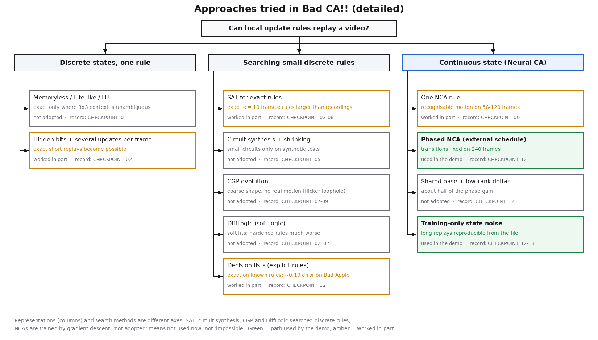

# How we got here

**What this page is:** the decisions behind Bad CA!!, in the order they were made. Each step gives:
- the question;
- what was tried and why;
- what worked and what did not;
- what that led to next, and its cost.

Evidence links point to the original records (`docs/CHECKPOINT_NN.md`), which are kept unchanged. The table form is
[timeline.md](timeline.md), and the per-file index is [README.md](README.md).

## 1. Can simple local rules make a video?
**Question.** The starting idea was a classic cellular automaton: each cell's next value depends only on its 3×3
neighbourhood.

**Tried.**
- Memoryless lookup tables (LUTs), checked frame by frame.
- Life-like (totalistic) rules.
- A fully independent replayer, so results could not depend on the training code.

**Found.**
- Exact replay works only where the same 3×3 context never needs two different answers. Real video breaks that within
  a few frames: identical neighbourhoods must turn black in one place and stay white in another.
- A uniform frame (the black opening) has no local differences at all.

**Next.** Give cells memory.

Evidence: [CHECKPOINT_01](../CHECKPOINT_01.md), [RESEARCH_PHASE_07](../RESEARCH_PHASE_07.md) (Life-like pilot).

## 2. What if cells remember, and update several times per frame?
**Tried.**
- Hidden bits per cell and several substeps per frame, so information can travel and be stored.
- Exact rules searched with SAT solvers: cold start, incremental, and repair from learned starts.
- Soft relaxations (DiffLogic) as a comparison.

**Found.**
- Hidden state makes exact short replays possible, up to about 10 frames.
- But 20–40 frames timed out, and the exact rules were larger than every recording of the same frames.
- Incremental SAT and learned starts did not speed the search up.
- Soft rules fitted, but lost much of their quality when hardened to discrete rules.

**Next.** Stop asking for exactness; look directly for *small* rules that are approximately right.

Evidence: [CHECKPOINT_02](../CHECKPOINT_02.md), [CHECKPOINT_03](../CHECKPOINT_03.md), [CHECKPOINT_04](../CHECKPOINT_04.md).

## 3. Can we search for small rules directly?
**Tried.**
- Direct synthesis of small Boolean circuits, measured by total file bytes.
- Cartesian Genetic Programming (CGP) evolution.
- A motion-aware objective, with loophole baselines fixed in advance.
- Later, readable decision-list rules (if/then over neighbour counts, with up to 3 hidden bits), learned by a small
  decision-tree learner and executed exactly in Python, Node and the browser.

**Found.**
- Small circuits compressed only synthetic test clips.
- On Bad Apple, 3–10-gate circuits followed the coarse shape but not the motion. Their late "motion" scores came from
  edge flicker, a metric loophole that the baselines exposed.
- Decision lists recover known rules exactly (Conway's Life as 3 rules). On Bad Apple, executed on their own, they
  collapse to "hold the frame", or to flicker if changes are up-weighted. The best is ~0.10 error on 56 frames, and only
  when switching programs every 4 frames.

**Next.** Small discrete rules did not reproduce motion. The project chose to give up "small" in favour of "actually
replays the video", and moved to continuous state.

Evidence: [CHECKPOINT_05](../CHECKPOINT_05.md)–[08](../CHECKPOINT_08.md), [CHECKPOINT_12](../CHECKPOINT_12.md) §4.

## 4. What if the state is continuous?
**Tried.**
- A Neural CA (NCA): 16 continuous channels per cell (1 visible, 15 hidden).
- A learned 3×3 perception, a ReLU, and a residual update.
- 4 substeps per frame; 10,320 float32 parameters.
- Trained end to end on a clip from its first frame.

**Found.**
- It replays a short real action (56–60 frames) from the first frame with recognisable motion, which CGP never did.
- What looked like "noise" turned out to be 1–2 px contour errors and under-motion.
- Longer training and a contour-weighted loss brought the error down to 0.004 / 0.013.
- 120 frames of one scene also worked (error ≈ 0.031).
- Smaller models (1,304 and 3,884 parameters) did not hold the quality.
- A 240-frame stretch containing a wipe and a cut failed with one rule.

**Cost.** This is not a small rule set, and the model file is far larger than a recording.

**Next.** Explain the 240-frame failure: was it the length, or the scene changes?

Evidence: [CHECKPOINT_09](../CHECKPOINT_09.md), [CHECKPOINT_10](../CHECKPOINT_10.md), [CHECKPOINT_11](../CHECKPOINT_11.md).

## 5. What if the rule changes with the scene?
**Tried.**
- A time-varying CA: one rule per phase on an *external* schedule, with the state carried across the switch.
- Phases trained jointly, so earlier phases can prepare hidden state for later ones.
- Compared against a single rule with the same total number of parameters.
- Automatic phase boundaries (a minimum-description-length segmentation of the video) against equal spacing.
- A shared base rule plus small low-rank changes per phase.

**Found.** On the 240-frame stretch, with 2 seeds and the same steps:
- one rule: 0.065–0.072;
- a single rule as large as four phases: 0.045–0.047;
- 4 phases: 0.027–0.033;
- 6 phases: 0.019–0.022;
- errors around the wipe and cut fell from ~0.13 to ~0.03–0.05;
- on a stretch without cuts, phases did not clearly help;
- automatic boundaries were never better than equal spacing;
- shared base + deltas gave about half the gain.

**Next.** Scale to the whole song.

Evidence: [CHECKPOINT_12](../CHECKPOINT_12.md) §2–3.

## 6. How do we keep long replays stable?
**Tried.** The whole song in chunks of consecutive phases, with the state carried from chunk to chunk.

**Found.**
- Training reported low errors, but the replay from the exported file followed training only for ~1,080 frames.
- Tiny float differences between the GPU state used in training and the CPU replay grew until the trajectory left
  everything that was trained, and the hidden values exploded.
- **Repair:** add small Gaussian noise to the state during training only, so a rule must tolerate small perturbations.
  With it, the replay matched training in every tested chunk, and the first 48.9 s (frames 0–1467) pass every check.
- **Further fixes:** chunk states are now carried with the same numpy arithmetic as the replay, so every chunk's true
  replay error is known during training. Weighting the loss towards fast transitions reduced the worst wipe error
  (0.159 → 0.120). It did not remove it.

**Result.** With these, the whole song (frames 0–6571, 110 phases) replays from the exported file in numpy, Node and
the browser. It passes acceptance criteria fixed before the run, including checks that a merely blurred original fails:
error 0.0152, every 240-frame window ≤ 0.041. Three short stretches at fast wipes and cuts remain weak (1.5 % of
frames). It is one seed; reproducibility of the procedure is checked separately. See [CHECKPOINT_13](../CHECKPOINT_13.md).

Evidence: [CHECKPOINT_12](../CHECKPOINT_12.md) §6, [CAMPAIGN_13](../CAMPAIGN_13.md).

## 7. After the full song: smaller rules, other videos, other mechanisms
With a working replay, the question went back to the original one: is there something smaller and more readable
underneath it? Each attempt below has its own record.

- **Learned logic gates** ([path-d](../path-d/README.md)). Differentiable logic-gate rules, hardened into real AND/OR/XOR
  circuits and simplified, recovered known synthetic rules exactly: Game of Life, and an excitable-wave rule in 9
  gates, even from the visible channel alone. On Bad Apple they held a shape for about 8 frames within one kind of
  motion, then collapsed into blobs and wedges.
- **A few shared rules plus a mode switch** ([context-s0](../context-s0/README.md)). If the video's local behaviour fell
  into a handful of reusable modes, a fixed rule plus a small control code might do. It doesn't: a shared codebook of
  local rules explains new scenes no better than a plain image shift, and the right mode cannot be picked from the
  past frames.
- **Cells that carry velocity** ([path-v](../path-v/README.md)). With hand-picked (oracle) nudges every few frames, a
  velocity-carrying automaton follows real motion, but about as well as moving blocks of the image with the same
  amount of control. One nudge keeps working only for plain translation. This record also adds a difficulty map of
  the whole video, and shows that the earlier failures were not just caused by cuts.
- **Another film** ([generalization](../generalization/README.md)). The full-song recipe, retrained on *Fantasmagorie*
  (1908, public domain), replays all 1,687 animation frames (6.6 % wrong pixels vs 1.5 % for Bad Apple). Single shared
  rules trained on many short clips only reach "hold the last frame" quality on unseen clips. More data helps a
  little, higher resolution helps a bit more, and a model trained on one video does not work on the other.
- **Shape-aware rules** ([shape](../shape/README.md)). A coarse grid of control points that bends the picture smoothly
  keeps thin rings and arms connected where pixel shifts tear them, on synthetic shapes. On real frames the gain is
  small.

**Where that leaves things.** Local rules can *replay* this animation when they have hidden memory and a schedule. No
small local law we found *predicts* it: the next frame is usually not decided by what a cell can see.
